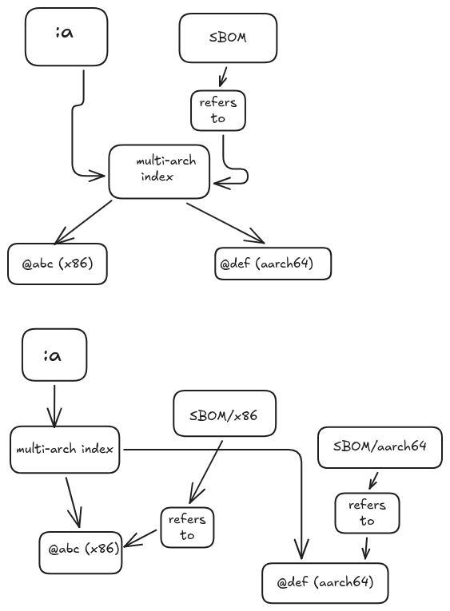
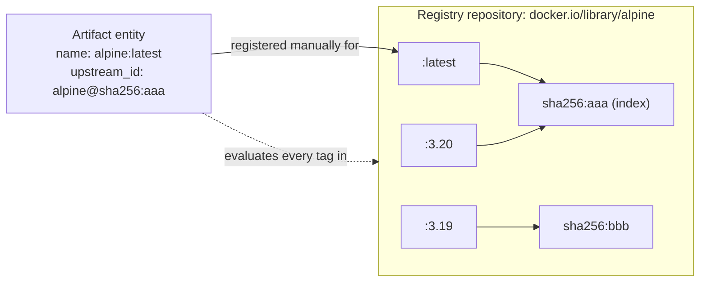
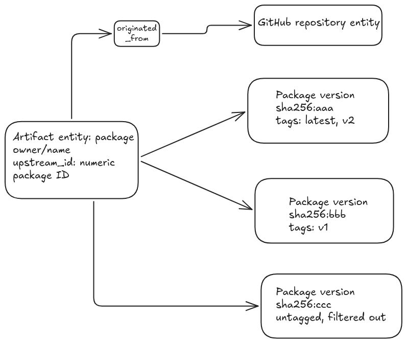
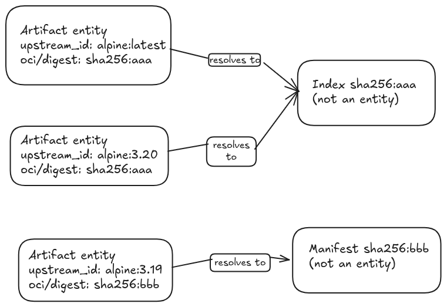

# Tag and Manifest Entities for OCI Artifacts -- Design

**Author:** Shreya Baranwal
**Status:** Draft
**Related issue:**
[#6954](https://github.com/mindersec/minder/issues/6954)

---

## Abstract

**TL;DR:** pivoting from Option B to Option A with a redefined `upstream_id`
(`repo:tag`). See Section 12.

Code references point to `main` at [`900dae34d`](https://github.com/mindersec/minder/tree/900dae34d72c69bdc1fd9f86ace9aeeef03a9d65).

Throughout this document, statements about current behaviour are marked as follows:

- **Verified:** Confirmed by code, a PR, an issue, or fetched documentation.
- **Inferred:** Based on code inspection but not verified by running it.
- **Unverified:** Not yet confirmed by code inspection, execution, or documentation.

## Background

This design takes the following as given:

- People want to manage OCI registries through policy.
- OCI registries think in terms of tags and manifests. A tag is a mutable
  alias; a manifest is content-addressed and immutable.
- Zero or more tags can point to a given manifest at the same time.
- A manifest's digest never changes; the manifest a tag points to can.

## 1. Context

Since [#6808](https://github.com/mindersec/minder/pull/6808), DockerHub and Quay artifact entities represent a repository and a tag. The entity name is typically `repo:tag`, while its `upstream_id` is `repo@<digest the tag points to>` ([`dockerhub.go`](https://github.com/mindersec/minder/blob/900dae34d72c69bdc1fd9f86ace9aeeef03a9d65/internal/providers/dockerhub/dockerhub.go#L170-L193)). **Verified.**

GitHub Container Registry (GHCR) uses a different model: an artifact entity represents a package containing multiple versions ([`artifact.go`](https://github.com/mindersec/minder/blob/900dae34d72c69bdc1fd9f86ace9aeeef03a9d65/internal/providers/github/properties/artifact.go#L156-L171)). **Verified.**

A GHCR package is the top-level container for all versions of one image name
under an owner (`ghcr.io/owner/name`), and each push creates a new package
version. `GetArtifactVersions` returns one Minder version per digest, and each
version carries every tag pointing at that digest
([`common.go`](https://github.com/mindersec/minder/blob/900dae34d72c69bdc1fd9f86ace9aeeef03a9d65/internal/providers/github/common.go#L955-L991)).
**Verified.** GHCR therefore already de-duplicates by digest within a package;
it does not expose those versions as separate Minder entities.

These models have several problems and limitations:

| Problem | Evidence and status |
|---|---|
| DockerHub and Quay entities combine a mutable tag reference with an immutable digest. When a tag moves, the `upstream_id` changes while the entity remains the same. Option A addresses this by redefining `upstream_id` as `repo:tag` (Section 6). | [#6954](https://github.com/mindersec/minder/issues/6954); [`service.go`](https://github.com/mindersec/minder/blob/900dae34d72c69bdc1fd9f86ace9aeeef03a9d65/internal/entities/properties/service/service.go#L212-L221). **Verified.** |
| A `repo:tag` entity evaluates every tag in the repository rather than only the tag named by the entity. | [`oci.go`](https://github.com/mindersec/minder/blob/900dae34d72c69bdc1fd9f86ace9aeeef03a9d65/internal/providers/oci/oci.go#L211). **Inferred.** |
| On DockerHub and Quay, each tag pointing at a digest is evaluated independently. This is sometimes desired (different policies can legitimately apply per tag, even on the same digest) and sometimes duplicate work, depending on the rule. | [`oci.go`](https://github.com/mindersec/minder/blob/900dae34d72c69bdc1fd9f86ace9aeeef03a9d65/internal/providers/oci/oci.go#L248-L249); #6775 review. **Verified.** |
| Untagged manifests are not discovered on DockerHub and Quay, or are filtered out on GitHub. This is a limitation worth naming rather than a problem specific to one option: no option discovers them without registry support for enumerating untagged content. | [`versionsfilter.go`](https://github.com/mindersec/minder/blob/900dae34d72c69bdc1fd9f86ace9aeeef03a9d65/internal/providers/artifact/versionsfilter.go#L71-L74). **Verified.** |
| Evaluation history does not record the digest that was evaluated, making it difficult to identify the exact content associated with a historical result. | [`artifact.go`](https://github.com/mindersec/minder/blob/900dae34d72c69bdc1fd9f86ace9aeeef03a9d65/internal/engine/ingester/artifact/artifact.go#L125-L132). **Verified.** |
| DockerHub and Quay artifacts are only registered manually. There are no artifact push webhooks, and the reminder service currently covers repositories rather than artifacts. | [`dockerhub.go`](https://github.com/mindersec/minder/blob/900dae34d72c69bdc1fd9f86ace9aeeef03a9d65/internal/providers/dockerhub/dockerhub.go#L237-L242); [`reminder.go`](https://github.com/mindersec/minder/blob/900dae34d72c69bdc1fd9f86ace9aeeef03a9d65/internal/reminder/reminder.go#L206-L207). **Verified.** |

This is consistent with the discussion in the existing issues and PRs. Evan Anderson suggested in #6929 that tags and manifests should have separate entities. In #6808, the question of how to model multiple tags pointing to the same digest was left open.

The goal of this design is to determine which entity model best represents OCI artifacts and how it supports policy evaluation, history, discovery, and lifecycle management.

## 2. Goals and non-goals

### Goals

- Define how OCI repositories, tags, manifests, and indexes should be represented.
- Establish a stable `upstream_id` for each entity type.
- Define how tag movement affects entity identity and evaluation history.
- Compare the proposed models against concrete policy scenarios before implementation.
- Describe how registry push events and GitHub package events map to the selected model.
- Identify migration requirements for existing entity data.

Repository entities and webhook support are planned as a subsequent milestone under [#6436](https://github.com/mindersec/minder/issues/6436).

### Non-goals

- Implementing the design. This document's goal is to decide the direction;
  implementing it (code, schema, and protobuf changes) is the job of a
  follow-up PR or issue, not out of scope for the effort as a whole.
- Fixing all implementation bugs. This design targets systemic issues, not
  every bug; known bugs are tracked in Section 14 or in separate issues.
- Implementing registry authentication. It may be necessary, particularly
  given DockerHub rate limiting, but is not part of this design.
- Implementing specific policies for OCI registries in the Minder codebase.
  The primitives in this design should let the Rego and jq evaluators express
  policies such as image signing without hard-coding evaluation logic.
- Adding support for new registries such as Harbor, ECR, GAR, or ACR.

## 3. Policy scenarios

The following scenarios are the policies the entity model needs to support.
Each scenario notes how Options A, B, and C (described in Section 6) handle
it, distinguishing what the entity model enables from what still depends on
discovery, event delivery, and reconciliation. The A notes describe today's
behaviour; redefining A's `upstream_id` changes identity, not discovery.

Entity-at-a-time evaluation may not work cleanly with nested objects: a
manifest can be either an index (manifest list) or an individual manifest,
which can make rules harder to write. This is part of why Option B's
cross-entity lookup risk matters (Section 6).

1. **(a) Every image under `platform/supported/` must be signed.**
   - **A:** Each `repo:tag` must be registered manually. Selection can use
     `oci/repository` (#6929). Each registered entity may re-check every tag
     in the repository. New pushes are not automatically discovered.
   - **B:** Manifest rules can select by `oci/repository` and evaluate each
     discovered digest. Complete coverage depends on repository enumeration,
     push-event processing, and reconciliation.
   - **C:** Same content-level model as B. Complete coverage depends on
     discovery and reconciliation.
2. **(b) `latest` must never point to an unsigned manifest.**
   - **A:** A rule can filter with `tags: [latest]`, but a tag move is not
     automatically detected or evaluated.
   - **B:** A rule can select the Tag named `latest` and evaluate its current
     target digest. Push processing and reconciliation determine how quickly a
     change is observed.
   - **C:** C1 can select Manifests whose current tags include `latest`; C2
     can evaluate the Repository's tag map. Both require tag-state updates and
     evaluation triggers.
3. **(c) Alert when a tag moves to a new digest.**
   - **A:** A change to `upstream_id` is not recorded as an explicit movement
     event. The history does not retain the evaluated digest.
   - **B:** Compare the Tag's previously observed digest with the newly
     resolved digest. A property-change trigger or persisted prior state is
     required; neither exists today.
   - **C:** Requires previous and current tag state, either through the
     Repository map (C2) or equivalent persisted information.
4. **(d) Every image must support amd64 and arm64.**
   - **A:** Possible through the raw index, but the same content may be
     checked once per tag. An index without `linux/amd64` may also break
     version listing.
   - **B:** Under B1, evaluate the index's platform descriptors once per
     digest. Under B2, platform manifests can be evaluated independently.
   - **C:** Same content-level approach as B, with the same B1/B2 choice.
5. **(e) One digest has three tags: how many evaluations occur?**
   - **A:** Three registered entities may each evaluate the same digest.
     Estimated: three status rows and nine verifications, depending on the
     evaluation path. **Inferred.**
   - **B:** Manifest-level rules can evaluate the digest once per evaluation
     cycle; Tag-level rules remain per Tag. Cross-entity reuse is not
     automatic.
   - **C:** Manifest-level rules can evaluate the digest once per evaluation
     cycle.
6. **(f) An image is pushed by digest without a tag.**
   - **A:** Not discovered by the current tag-based model.
   - **B:** Can represent a Manifest without Tags if its digest is discovered
     through another mechanism. Existing push payloads do not provide
     sufficient information to guarantee discovery of every untagged Manifest.
   - **C:** Same limitation as B.
7. **(g) Every tagged image has an SBOM.** An SBOM is attached to a manifest
   through the referrers API, so "tag `v3` has an SBOM" means "the manifest
   that `v3` points to is referred to by an SBOM manifest". There are two
   possible configurations: one SBOM referring to the index, or one SBOM per
   platform manifest.

   

   - **A, B, and C:** Unresolved. It is not yet clear who calls the referrers
     API under either Option A or B, and therefore who decides which
     configuration to support. Pending walkthrough.

## 4. Terminology

| Term | Definition |
|---|---|
| Repository | A named collection of artifacts within a registry, such as `docker.io/library/alpine`. In the OCI Distribution API, this corresponds to the repository name in `/v2/<name>/...`. |
| Tag | A mutable reference within a repository that points to a manifest or index, such as `latest`. |
| Manifest | An immutable document describing an image, including its configuration and layer references. It is identified by its digest. |
| Index | An immutable manifest that references other manifests, typically for different platforms. Also known as a manifest list. |
| Platform manifest | A manifest referenced by an index for a particular platform, such as `linux/arm64`. |
| Digest | A content identifier derived from a cryptographic hash, such as `sha256:294b683c…`. The digest identifies the specific content being referenced. |
| Package | A GHCR-specific term, not part of the OCI standard. The top-level container for all versions of one image name under an owner, such as `ghcr.io/owner/name`. Each push creates a new package version. |
| Referrers API | A [distribution-spec mechanism](https://github.com/opencontainers/distribution-spec/blob/main/spec.md#listing-referrers) to discover manifests, such as SBOMs and signatures, that reference a given manifest's digest as their `subject`, without needing a tag. |

For this design, the distinction between a tag and a manifest is important: **a tag can change what it points to, but a manifest's digest identifies immutable content.**

## 5. Current model

DockerHub, Quay, and GHCR currently use different entity models.

| Aspect | DockerHub / Quay | GitHub Container Registry |
|---|---|---|
| Entity | One entity per registered `repo[:tag]`. **Verified.** | One entity per package, covering all versions of one image name under an owner. **Verified.** |
| Name | For example, `alpine:latest`. A bare `alpine` defaults to `latest` during resolution but is stored as `alpine`. See [`oci/artifact.go`](https://github.com/mindersec/minder/blob/900dae34d72c69bdc1fd9f86ace9aeeef03a9d65/internal/providers/oci/artifact.go#L32-L41). | `owner/name`. See [`artifact.go`](https://github.com/mindersec/minder/blob/900dae34d72c69bdc1fd9f86ace9aeeef03a9d65/internal/providers/github/properties/artifact.go#L80-L100). |
| `upstream_id` | `repo@<tag's top-level digest>`. Since #6862, this is the index digest when the tag resolves to a multi-platform index. See [`oci.go`](https://github.com/mindersec/minder/blob/900dae34d72c69bdc1fd9f86ace9aeeef03a9d65/internal/providers/oci/oci.go#L301-L309). | Numeric package ID. See [`artifact.go`](https://github.com/mindersec/minder/blob/900dae34d72c69bdc1fd9f86ace9aeeef03a9d65/internal/providers/github/properties/artifact.go#L158). |
| Unit of a version | One version per tag; a digest with several tags appears once per tag. **Verified.** | One version per package version (digest), carrying every tag that points at it. **Verified.** |
| What gets evaluated | Every tag in the repository, subject to six-month retention and the rule's `tags` or `tag_regex` filters. One version is produced per tag. See [`oci.go`](https://github.com/mindersec/minder/blob/900dae34d72c69bdc1fd9f86ace9aeeef03a9d65/internal/providers/oci/oci.go#L206-L255). | Every active package version, with one version per digest and all associated tags, subject to the same filters. See [`common.go`](https://github.com/mindersec/minder/blob/900dae34d72c69bdc1fd9f86ace9aeeef03a9d65/internal/providers/github/common.go#L955-L991). |
| When a tag moves | The entity keeps its name; its `upstream_id` changes on the next non-stale refresh. **Verified.** | The tag moves between package versions inside the same package entity; the package ID is unaffected. **Inferred.** |
| Evaluation history | Keyed by `(rule_id, entity_instance_id)`, with one status per evaluation. The checkpoint stores a timestamp. See [`history/service.go`](https://github.com/mindersec/minder/blob/900dae34d72c69bdc1fd9f86ace9aeeef03a9d65/internal/history/service.go#L101-L127). | Same history model. |
| Parent relationship | No parent link. | `originated_from` points to the repository when the entity is created by the `package` webhook. See [`handlers_packages.go`](https://github.com/mindersec/minder/blob/900dae34d72c69bdc1fd9f86ace9aeeef03a9d65/internal/providers/github/webhook/handlers_packages.go#L95-L100). |
| Creation | Manual `RegisterEntity` only. | `package.published` webhook or manual `RegisterEntity`. |

The current model therefore treats the tag as the entity's identity while also using the tag's resolved digest to identify the content. The following options explore ways to separate those concerns.

### Diagrams

Current DockerHub / Quay model:

Current GHCR model:

Proposed model (Option A with a redefined `upstream_id`):

When `latest` moves, its entity keeps the same `upstream_id`; only
`oci/digest` changes. Whether GHCR converges on this model is open (Q2 in
Section 13).

## 6. Design options

### Option A: One entity per tag, identified by `repo:tag`

Each artifact entity represents a repository and a tag. Today its
`upstream_id` is `repo@digest`; this design redefines it as `repo:tag` (or
`repo@tag`).

Both entities can point to the same digest, but each is evaluated independently.

A "moved" tag is a delete-and-recreate at the registry level, so the tag name
itself is the stable identity. The digest the tag currently resolves to
becomes a property (`oci/digest`) rather than part of the identity. This
resolves the mutable `upstream_id` described in Section 1. DockerHub and
Google Artifact Registry appear not to allow renaming repositories, so a
name-based identity is not affected by server-side renames. **Unverified.**

A name registered without a tag (stored today as `alpine`) would need to
normalise to `alpine:latest` so the identity is unambiguous. **Inferred.**

| Entity | `upstream_id` | Multi-platform behaviour |
|---|---|---|
| Artifact (`repo:tag`) | `repo:tag`, which stays the same when the tag moves. The current target digest is stored in `oci/digest`. | The index digest is used as the version's `Sha`. Platform manifests remain inside the raw index passed to Rego. See [`oci.go`](https://github.com/mindersec/minder/blob/900dae34d72c69bdc1fd9f86ace9aeeef03a9d65/internal/providers/oci/oci.go#L164-L179). |

#### Advantages of Option A

- Requires the fewest conceptual changes to the existing model.
- Keeps tag-based policy selection straightforward.
- Gives each tag a stable identity, so tag-move history can be attached to
  one entity (Section 7).
- Avoids cross-entity reconciliation. A push combined with a tag move can
  produce N+1 manifests and a tag update in one burst of events; under B this
  requires reconciling several entity types, while A does not.
- Avoids the cross-entity lookup problem described under Option B.

#### Observations and limitations of Option A

- Each tag is evaluated independently. This is sometimes desired (different
  policies can legitimately apply per tag, even on the same digest) and
  sometimes duplicate work, depending on the rule.
- Untagged manifests are not discovered. This is a limitation worth naming
  rather than a problem specific to A: B and C do not solve it either without
  registry support for enumerating untagged content.
- Tag movement is recorded through `oci/digest` and evaluation history
  (Section 7) rather than as an explicit entity transition.
- Content-level policies remain dependent on tag-based discovery.

#### Alternatives considered for Option A

Keeping today's `repo@digest` identity was considered. It was not chosen
because the identity changes whenever the tag moves, which defeats the
purpose of `upstream_id` as a durable identifier.

### Option B: Introduce separate Tag and Manifest entities

Under this model, a Tag represents a mutable reference, while a Manifest represents immutable content. Multiple Tags can point to the same Manifest, and a Manifest can exist without any Tags.

#### Candidate identities

| Entity | Candidate `upstream_id` | Notes |
|---|---|---|
| Tag | `repo:tag` | Registries do not expose a separate tag ID, so the repository and tag name form the identity. Deleting and recreating the same tag would reuse that identity. The current target digest could be stored in a property such as `oci/digest`. |
| Manifest | `repo@digest` for DockerHub and Quay. For GHCR, either a package version ID or `repo@digest` remains under consideration. | The digest identifies immutable content. Including the repository keeps copies of the same digest in different repositories distinct, addressing the identity concern raised in #6808. |
| Platform manifest | B1: Keep platform manifests as data inside the index Manifest. B2: Represent each platform manifest as its own `repo@digest` entity. | B2 requires a relationship between an index and its child manifests. A child may be referenced by multiple indexes. |

A tag and a platform manifest could also both point directly at the same
child manifest inside an index, for example a `linux/amd64`-only tag pointing
at a manifest that is also a platform manifest of an index. This is an
unresolved modeling question for B2 if B is revisited; it does not block the
A direction.

#### Advantages of Option B

- Separates mutable references from immutable content.
- Provides a natural place for tag-specific policies and tag-movement history.
- Allows content-level checks to be associated with a digest rather than repeated for every tag.
- Provides a model for manifests that exist without tags, provided they can be discovered.

#### Limitations of Option B

- Requires explicit lifecycle handling for Tags and Manifests.
- Requires a mechanism to detect changes to a Tag's target digest.
- Reusing Manifest evaluation results from Tag rules requires additional cross-entity lookup or equivalent functionality.
- B2 introduces relationships that the current `originated_from` model cannot represent.

`originated_from` is `ON DELETE CASCADE` and models lifecycle ownership: when
a parent is deleted, the entities that originated from it are cleaned up.
Tag → Manifest is not ownership. It is a point-in-time reference that changes
without either side being deleted, so cascading a delete through it would be
wrong. Given the move to Option A this may be moot, and it is low priority to
resolve further.

#### Alternatives considered: why Option B was set aside

Option B was this document's original recommendation. It was set aside
because of cross-entity lookup: a Tag rule either duplicates the Manifest's
content check, which gives no real improvement over A, or needs to look up
the Manifest's evaluation result. Cross-entity result lookup does not exist
today and is risky to build.

### Option C: Introduce Manifest entities only, with tags stored as data

This model does not introduce separate Tag entities. Instead, tag information is maintained either on the Manifest or on a Repository entity.

Two variants are possible:

- **C1:** A Manifest stores its current tags in a property such as `oci/tags`.
- **C2:** A Repository stores a mapping from tag names to digests.

| Entity | Candidate `upstream_id` | Notes |
|---|---|---|
| Manifest | `repo@digest` | Same identity approach as Option B. |
| Tags | No separate entity | When a tag moves, the old Manifest loses the tag and the new Manifest gains it under C1. Under C2, the corresponding Repository mapping is updated. |
| Platform manifest | Same B1/B2 decision as Option B. | |

#### Advantages of Option C

- Keeps the entity model smaller.
- Supports content-level evaluation and digest-based deduplication.
- C2 can centralise tag state and potentially simplify repository-level policies.

#### Limitations of Option C

- Tag movement is not naturally represented as a first-class entity transition.
- C1 requires updating tag information on the affected Manifests.
- C2 requires Repository-level state and policy support.
- Historical tag movement still requires persisted previous state or an equivalent event history.

#### Alternatives considered: why Option C was set aside

C1 is retired from serious consideration. The entity model has no precedent
for set-style properties, and during a race the same tag could appear in two
Manifest entities' property lists. C2 is set aside alongside C1.

### What the scenarios tell us

Options B and C provide a clearer model for content-level checks and can avoid repeated evaluation of the same digest. However, deduplication depends on rule configuration and evaluation semantics; it is not guaranteed merely by creating Manifest entities.

Option B gives mutable references a first-class identity, which makes tag-specific policies and movement tracking easier to express.

Redefining Option A's `upstream_id` as `repo:tag` also gives each tag a
stable identity, without B's cross-entity lookup.

Scenario c still requires previous-state tracking or an equivalent change-detection mechanism regardless of the selected entity model.

The word **"never"** in scenario b also deserves clarification. An asynchronous webhook-based system can detect and report that a tag now points to unsigned content, but it cannot guarantee that the tag never briefly points to such content. Preventing publication of unsigned content would require an enforcement mechanism beyond post-publication evaluation.

## 7. Identity and evaluation history

The main identity question is what remains stable when a tag changes its target.

| Option | Stable `upstream_id` | Behaviour when a tag moves |
|---|---|---|
| A | Stable: `repo:tag` (redefined; see Section 6). Today it is `repo@digest`, which follows the tag's current target. | The entity, its `upstream_id`, and its history row stay the same; only `oci/digest` changes. Today, the `upstream_id` is updated during a subsequent non-stale refresh, such as a profile change or `GetArtifactById` call. See [`refresh_by_id.go`](https://github.com/mindersec/minder/blob/900dae34d72c69bdc1fd9f86ace9aeeef03a9d65/internal/entities/handlers/strategies/entity/refresh_by_id.go#L55-L57). Historical results do not identify the digest that was evaluated. |
| B | Tag: `repo:tag`. Manifest: `repo@digest`. | The Tag keeps its identity while its target digest changes. Each Manifest retains its own identity and history. Recording the evaluated digest in the checkpoint's existing `Digest` field could make Tag history auditable; the field is currently unused by the artifact ingester. See [`checkpoints.go`](https://github.com/mindersec/minder/blob/900dae34d72c69bdc1fd9f86ace9aeeef03a9d65/pkg/entities/v1/checkpoints/checkpoints.go#L37-L39). |
| C | Manifest: `repo@digest`. | Manifest history remains stable, but the model does not inherently preserve what a tag pointed to in the past. That information must be captured separately, either through evaluation output under C1 or through persisted Repository state and history under C2. |

Under B, a useful distinction is:

- **Tag history:** Which digest did the tag point to when a particular evaluation occurred?
- **Manifest history:** What were the results of evaluating a specific immutable digest?

These are related but different questions. The implementation should make both answerable without relying on the current value of a mutable property.

Tracking the history of tag → digest resolution is useful under Option A as
well as B, and carries over to the redefined A.

### Follow-ups

- **Surface the evaluated digest.** Recording the digest in the checkpoint's
  `Digest` field only helps if it is surfaced. `ListEvaluationResultsHistory`
  does not currently return the checkpoint. This is a follow-up requirement,
  not only a storage change.
- **Extend `EvaluationHistory`.** Once the checkpoint gap above is addressed,
  consider extending the `EvaluationHistory` message to carry the evaluated
  digest or tag target directly.
- **Registry constraints.** Push and tag-ordering constraints vary by
  registry: ECR requires a repository to exist before it is pushed to, while
  other registries create it automatically. This is one more thing Minder can
  observe but not enforce.

## 8. Events and discovery

The proposed model depends on how each registry exposes tag and manifest changes.

### Existing event payloads

- **DockerHub push:** Includes `push_data.tag`, `pusher`, `pushed_at`, and repository information. The documented payload does not include the digest or a delete event. See the [Docker Hub webhook documentation](https://docs.docker.com/docker-hub/repos/manage/webhooks/), fetched 2026-10-25.
- **Quay Repository Push:** Includes repository and namespace information, `docker_url`, and `updated_tags[]`. The cited notification guide does not establish a digest or delete event in the payload. See the [Quay notification guide](https://docs.quay.io/guides/notifications.html). Newer Red Hat documentation remains unverified.
- **GitHub `package` event:** The current handler processes only `published`. The payload struct includes `package_version.container_metadata.tag.{name,digest}`, but the values are not currently used. Whether GitHub reliably populates the digest field remains unverified. See [`handlers_packages.go`](https://github.com/mindersec/minder/blob/900dae34d72c69bdc1fd9f86ace9aeeef03a9d65/internal/providers/github/webhook/handlers_packages.go#L45-L80).

In summary, all three sources (DockerHub, Quay, and GHCR) reliably provide a
tag name in push payloads; none reliably provides the digest of the pushed
content. Every option therefore needs an extra request to resolve the digest.

### Event-handling principle

An event is a prompt to re-check the current state at the source, not a
payload to trust or apply in order. Events may be duplicated, dropped, or
delivered out of order, and correctness does not rely on ordered, reliable
delivery. When an event arrives, Minder re-reads the current state from the
registry rather than applying the event's contents.

### Event handling by option

| Event | A: One entity per tag | B: Tag + Manifest | C: Manifest only |
|---|---|---|---|
| DockerHub/Quay push | Upsert the `repo:tag` entity and refresh its properties. | Upsert the Tag, resolve its current digest, upsert the Manifest, update the Tag's target, and evaluate the relevant rules. | Resolve the digest, upsert the Manifest, and update its tag information or the Repository's tag map. Under C1, the previous Manifest may also need updating. |
| GitHub `package.published` | Keep the existing package-based flow. | Treat the event only as a prompt to re-check: fetch the tag and its current digest from the registry rather than taking them from the event payload, then follow the same upsert flow. | Same discovery and state-update requirements as B. |
| Tag or Manifest deletion | No deletion event is currently handled. | Detect removal through periodic reconciliation and update the Tag and Manifest lifecycle appropriately. | Detect removal through reconciliation and update the Manifest's tag data or Repository map. |

Under every option, deletion detection and drift correction require a reconciliation mechanism that compares stored state with registry state. The existing reminder service covers repositories only.

Push events alone do not guarantee complete discovery. In particular, an event that names a tag is not equivalent to an event that identifies every manifest in a repository.

## 9. Relationships

The current entity model supports an optional parent through `originated_from`, with `ON DELETE CASCADE` semantics. See [`000090_entity_properties.up.sql`](https://github.com/mindersec/minder/blob/900dae34d72c69bdc1fd9f86ace9aeeef03a9d65/database/migrations/000090_entity_properties.up.sql#L13).

This design should be revisited if and when the entity links mentioned in
[#6105](https://github.com/mindersec/minder/issues/6105) land.

| Relationship | A | B | C | Compatibility with `originated_from` |
|---|---|---|---|---|
| Repository → Tag | Represented through the artifact entity | Yes | Not applicable | Fits the ownership relationship. Deleting a Repository should remove its Tag entities if this is the intended lifecycle. |
| Repository → Manifest | Not explicitly represented | Yes | Yes | Fits the ownership relationship, subject to the chosen retention and deletion rules. |
| Tag → Manifest | Not applicable | Yes, as a mutable many-to-one reference | Not applicable | Does not fit. The relationship changes over time and should not cause cascading deletion. A target-digest property is one possible initial approach. |
| Index → platform Manifest | Not explicitly represented | Only under B2 | Only under the corresponding C-B2 variant | Does not fit a single-parent ownership model because a child Manifest can appear in multiple indexes. |

For the initial implementation, keeping platform manifests inline avoids introducing a many-to-many relationship model. Tag-to-Manifest references should remain distinct from ownership relationships.

The OCI distribution spec's
[Deleting Manifests](https://github.com/opencontainers/distribution-spec/blob/main/spec.md#deleting-manifests)
section states that once a manifest is deleted, "any tag pointing to that
digest will return a 404". Deleting a tag does not delete the manifest. If
Tag and Manifest entities are introduced (Option B), deletion can be handled
by deleting both entities directly rather than routing it through
`originated_from`. Ownership does not fit a relationship whose direction
depends on which side triggered the change.

## 10. Migration

The migration requirements differ between DockerHub/Quay and GHCR.

### Current deployment state

- No release contains #6808.
- v0.3.2 corresponds to the #6775 merge commit, and DockerHub/Quay `SupportsEntity` returns false there. **Verified.**
- DockerHub/Quay artifact entities exist only on deployments running `main` since 2026-10-05.
- GitHub package entities are already released.
- The public instance (`api.custcodian.dev`) runs a rolling release from the
  Helm charts rather than pinned release tags. Migrations can backfill or
  modify entities as needed rather than treating every change as a hard
  migration.
- On that instance, DockerHub is enabled and Quay is disabled, and there is
  likely little or no actual DockerHub integration usage yet. This lowers
  migration urgency.

### Migration by option

| Option | DockerHub / Quay | GitHub / GHCR |
|---|---|---|
| A | Existing entities' `upstream_id` changes from `repo@digest` to `repo:tag`, which can be done as a backfill. | No migration required. |
| B | Existing `repo:tag` entities can be converted to Tag entities while preserving their names, or deleted and registered again. Deletion may cascade to history. The implementation must decide whether Tags and Manifests become new entity types or use a `kind` property on `ENTITY_ARTIFACTS`. | Migration is optional if the package entity remains the top-level entity. Converting packages into Repository entities and versions into Manifest entities would require migrating released data. |
| C | Existing entities can be converted or deleted and recreated as Manifest entities, using the current `upstream_id` as a starting point for the new identity. | Same broad migration consideration as B. |

Other stored data is associated with entity UUIDs, including evaluation statuses, outputs, alerts, remediations, exceptions, and profiles whose selectors or `params.name` values assume the existing `repo:tag` model. See [`models.go`](https://github.com/mindersec/minder/blob/900dae34d72c69bdc1fd9f86ace9aeeef03a9d65/internal/db/models.go#L551-L595) and [`000120_exceptions.up.sql`](https://github.com/mindersec/minder/blob/900dae34d72c69bdc1fd9f86ace9aeeef03a9d65/database/migrations/000120_exceptions.up.sql#L11).

A migration plan should explicitly address whether these records are preserved, transformed, or intentionally discarded.

## 11. Registry request cost

The following estimates describe the current DockerHub/Quay flow per artifact rule and evaluation. They are inferred from code inspection and `go-containerregistry` v0.22.1, rather than confirmed through request-level measurements.

| Operation | Approximate requests per tag | Reference |
|---|---|---|
| List tags | Paginated; performed once per repository | [`oci.go`](https://github.com/mindersec/minder/blob/900dae34d72c69bdc1fd9f86ace9aeeef03a9d65/internal/providers/oci/oci.go#L49-L89) |
| `remote.Image` for creation time | One manifest GET, potentially one child-manifest GET for an index, and one config-blob request if no `created` annotation exists | [`oci.go`](https://github.com/mindersec/minder/blob/900dae34d72c69bdc1fd9f86ace9aeeef03a9d65/internal/providers/oci/oci.go#L220-L230) |
| `GetDigest` | One manifest GET | [`oci.go`](https://github.com/mindersec/minder/blob/900dae34d72c69bdc1fd9f86ace9aeeef03a9d65/internal/providers/oci/oci.go#L242) |
| `GetRawManifest` | One manifest GET | [`artifact.go`](https://github.com/mindersec/minder/blob/900dae34d72c69bdc1fd9f86ace9aeeef03a9d65/internal/engine/ingester/artifact/artifact.go#L222) |
| Signature lookup | One manifest GET for the image and one for the `.sig` tag | [`container.go`](https://github.com/mindersec/minder/blob/900dae34d72c69bdc1fd9f86ace9aeeef03a9d65/internal/verifier/sigstore/container/container.go#L409-L444) |
| **Estimated total** | **Approximately 5–7 requests per tag, including 5–6 manifest GETs in the described path** | Inferred |

### Cost multipliers

- Artifact ingestion is not cached, so each artifact rule repeats the ingestion work. See [`executor.go`](https://github.com/mindersec/minder/blob/900dae34d72c69bdc1fd9f86ace9aeeef03a9d65/internal/engine/executor.go#L108-L112).
- Under Option A, registering multiple tags from the same repository can repeat repository-wide processing.

### Mitigations and action items

- **Caching layer.** A caching layer can be added if Minder hits registry
  limits (notably DockerHub) or if ingestion is simply expensive. The cache
  is keyed by digest: each tag is first resolved to its digest, and the
  manifest and signature lookups are then cached by that digest. Because
  several tags that share a digest resolve to the same cache key, the content
  work is done once per digest rather than once per tag, without needing
  Manifest entities, which supports Option A.
- **Metrics.** Add OpenTelemetry meters for registry call volume, and possibly
  the credentials used, reusing what exists for the GitHub provider where
  possible.

### Rate limits

Docker Hub documents limits of 100 pulls per six hours per IP for anonymous users and 200 for authenticated personal accounts. Manifest GET requests count toward these limits; HEAD requests do not. See the [Docker Hub usage and pull limits documentation](https://docs.docker.com/docker-hub/usage/pulls/), fetched 2026-10-25.

The current OCI listing and manifest calls do not provide credentials in the cited code paths. See [`oci.go`](https://github.com/mindersec/minder/blob/900dae34d72c69bdc1fd9f86ace9aeeef03a9d65/internal/providers/oci/oci.go#L136). The resulting impact on anonymous rate limits is inferred.

For example, a repository with 20 tags inside the retention window may require approximately 100–120 manifest GETs for one rule. **This is an estimate, not a measured result.**

Quay's applicable limits remain unverified.

### Expected cost under B and C

- A Manifest evaluation is expected to require roughly three GET requests in the described path: one for the raw manifest and two for signature lookup.
- A Tag evaluation adds a digest-resolution request. This might be implemented with a HEAD request on Docker Hub, although #6862 retained GET for consistency.
- Event-driven evaluation could reduce repeated repository-wide scans, provided reconciliation and recovery from missed events remain available.

These estimates should be validated through request-level measurements before being used as implementation guarantees.

## 12. Tentative proposal

Direction: Option A, with a redefined `upstream_id`.

- **Identity:** One artifact entity per tag, with `upstream_id` `repo:tag` (or
  `repo@tag`). The current target digest is stored in `oci/digest`.
- **Tag-move history:** Tracked through the checkpoint's `Digest` field, and
  surfaced in `ListEvaluationResultsHistory` once that gap is fixed
  (Section 7).
- **Cost:** An optional caching layer for repeated-digest cost (Section 11).
- **Option B:** Documented as an alternative considered (Section 6). It was
  set aside because of the cross-entity lookup risk.

### Still open (pending walkthrough)

- What rule evaluation and ingestion look like concretely under the redefined
  Option A.
- Retention and garbage-collection policy (Q6 in Section 13).
- Sequencing: Repository entity first, or tag entities first. The author's
  instinct is that tag entities can ship independently of Repository
  discovery, but Repository-first may still make sense for
  `oci/repository`-scoped policy selection before tag discovery exists.

## 13. Open questions

1. **Entity types:** Should Tag and Manifest become separate entity types, or should `ENTITY_ARTIFACTS` use a `kind` property? This affects selectors, protobuf definitions, and the CLI.

2. **GHCR identity:** Should a GHCR Manifest use the package version ID or `repo@digest` as its `upstream_id`? Does GHCR expose platform manifests as separate untagged versions? This remains unverified; see #6829.
   GHCR also has quirks that may justify a custom implementation track rather
   than assuming full convergence on the same timeline as DockerHub and Quay:
   GitHub App tokens do not work for GHCR authentication, and GHCR likely
   tracks organization renames differently from DockerHub.

3. **Untagged manifest discovery:** Can any target registry enumerate untagged manifests? The OCI Distribution API's tag-listing endpoint alone does not establish complete manifest discovery.

4. **Tag movement:** Should changes be detected through a property-change trigger or through comparison with previously persisted state? Neither mechanism exists today.
   Persisted state gives a comprehensible history but can miss intermediate
   states, for example when `latest` is moved to the wrong digest and then
   corrected, or during a release. This trade-off is accepted rather than
   treated as solved.

5. **Cross-entity evaluation:** Out of scope; resolved by the move to Option
   A. Under A, each tag's rules evaluate that tag's content, so no
   cross-entity result lookup is needed. This was the strongest argument for
   A over B.

6. **Retention:** Which retention or aging-out policy determines when Manifests should be removed? Under B and C, the number of Manifest entities grows with every push. See the #6779 discussion.
   It is unresolved how registries handle garbage collection themselves. This
   is another point in A's favour: A does not accumulate a growing set of
   Manifest entities the way B and C do.

7. **Reconciliation:** Periodic reconciliation should be integrated into
   Reminder, which currently covers repositories only. A small follow-up issue
   should extend Reminder to cover artifact entities (and eventually all
   entity types). Run frequency still needs to respect registry rate limits.

8. **Signature scope:** Whether signatures are checked on the top-level index,
   the individual platform manifests, or both should be the rule implementer's
   choice, not a platform decision. The open question is whether the current
   Rego/jq surface makes it practical for a rule author to choose; this should
   be tried rather than assumed. See #6829.

9. **Failure semantics:** Moved to an implementation note. Distinguishing
   temporary registry failures from confirmed deletion does not affect the
   entity-model decision.

10. **Event ordering:** Answered in Section 8 (Event-handling principle).

11. **Sequencing:** What is the smallest useful first step: Manifest and Tag entities registered manually, or Repository entities with discovery first?

## 14. Related findings to track separately

These findings are related to the current OCI implementation but are outside the scope of this design.

| Finding | Status |
|---|---|
| `tags: [a, b]` may never match on DockerHub/Quay because each version carries one tag while the filter uses `HasAll`. See [`versionsfilter.go`](https://github.com/mindersec/minder/blob/900dae34d72c69bdc1fd9f86ace9aeeef03a9d65/internal/providers/artifact/versionsfilter.go#L115-L118) and [`oci.go`](https://github.com/mindersec/minder/blob/900dae34d72c69bdc1fd9f86ace9aeeef03a9d65/internal/providers/oci/oci.go#L248). | Inferred. |
| OCI listing and manifest calls do not pass credentials in the cited code paths, potentially affecting private repositories and rate limits. See [`oci.go`](https://github.com/mindersec/minder/blob/900dae34d72c69bdc1fd9f86ace9aeeef03a9d65/internal/providers/oci/oci.go#L136). | No authentication option in the cited code is verified; the impact is inferred. |
| An index without `linux/amd64` may cause `getImage` to fail and, consequently, the entire version listing to fail. See [`oci.go`](https://github.com/mindersec/minder/blob/900dae34d72c69bdc1fd9f86ace9aeeef03a9d65/internal/providers/oci/oci.go#L220-L223). | Inferred. |
| `GetArtifactByName` requires `owner/repo/name`, which may prevent lookup of slash-free DockerHub names such as `alpine:latest`. See [`handlers_artifacts.go`](https://github.com/mindersec/minder/blob/900dae34d72c69bdc1fd9f86ace9aeeef03a9d65/internal/controlplane/handlers_artifacts.go#L55-L68). | Inferred. |
| A repeated GitHub `package.published` event for an existing package may encounter the unique-name constraint and be dropped. See [`entity_creator.go`](https://github.com/mindersec/minder/blob/900dae34d72c69bdc1fd9f86ace9aeeef03a9d65/internal/entities/service/entity_creator.go#L144-L166) and [`handler.go`](https://github.com/mindersec/minder/blob/900dae34d72c69bdc1fd9f86ace9aeeef03a9d65/internal/entities/handlers/handler.go#L78-L85). | Inferred. |

## 15. Does this generalize beyond OCI?

This question was raised by [@intelligent-ears](https://github.com/intelligent-ears) on [#6954](https://github.com/mindersec/minder/issues/6954): at the Oct 22 community meeting, maintainers noted that release-style entities (e.g. npm, PyPI) have a similar gap, and Evan sketched a hierarchy along the lines of `Account → Distribution channel → Release → Artifact`. That hierarchy comes from the Oct 22, 2026 community meeting notes: ‘Evan came up with a quick set of possible entities around releases: Account (admin group within the distribution), Distribution channel (npm package, pypi package), Release (specific version), Artifact (component in that release, e.g. platform-specific binary).’ Verified.

**npm** has a concept that maps closely onto Tag and Manifest:

- A **dist-tag** (e.g. `latest`, `beta`) is "a human-readable label... used to provide an alias instead of version numbers" ([npm docs](https://docs.npmjs.com/adding-dist-tags-to-packages), [`npm dist-tag`](https://docs.npmjs.com/cli/v10/commands/npm-dist-tag)). **Verified.** A dist-tag maps to a single version, and `latest` moves to the newest version on every default `npm publish`. **Verified.** Any dist-tag, including `latest`, can be repointed with `npm dist-tag add`; the docs don't say outright that this replaces an existing mapping, but that follows directly from "maps to a single version." **Inferred.**
- A published `name@version` can never be republished or reused, even after `npm unpublish` removes it (subject to npm's unpublish policy). Its content is identified by a hash: `dist.integrity` (SHA-512) and the legacy `shasum` (SHA-1). **Verified.** `npm deprecate` is a reversible warning flag and does not touch the content. **Inferred.**
- A single version can carry more than one dist-tag at once: checking the live registry shows the `npm` package itself has both `latest` and `next-12` dist-tags pointing at the same version, `12.2.1`. **Verified** (observed directly, not stated in docs).

This maps onto the design the same way OCI does: **dist-tag ≈ Tag** (mutable, name-addressed, points to one target at a time, though a target can have several names), and **version ≈ Manifest** (immutable, content-addressed, can exist with zero or more tags pointing to it).

**PyPI** does not have an equivalent. There is no tag concept; files are grouped under each version, and each file carries a `sha256` and other hashes with a filename that can never be reused. **Verified.** Yanking a release hides it without deleting it, and can be undone. **Verified.** One caveat: PyPI files are fetched by filename and carry hashes for verification, not fetched by hash the way OCI blobs are, so calling them "content-addressed" in the same sense as a Manifest digest may overstate it. Whether new files can be added to an existing version after release remains **unverified**.

So the split doesn't generalize uniformly: it matches a registry that has a movable, name-based alias (npm, OCI) but has no direct counterpart where there's no such alias (PyPI, as checked here). That's consistent with treating Tag as "the mutable pointer a particular ecosystem happens to expose," rather than a feature every ecosystem must have.

**Follow-up pointer (later, not current scope):** Maven Central and crates.io
were raised in review as other registries to compare. Their models have not
been analyzed yet; that is later work.

## 16. Decisions

| Decision | Outcome |
|---|---|
| Entity model direction | Option A, with `upstream_id` redefined as `repo:tag`. Options B and C are recorded as alternatives considered in Section 6. |
| New entity types, or `ENTITY_ARTIFACTS` with a `kind` property | TBD — pending walkthrough. Option A does not require a new entity type. |
| Order of work: Repository entities first, or tag entities first | TBD — pending walkthrough (Section 12). |
| Signature scope: top-level index, platform manifests, or both | Rule implementer's choice, not a platform decision (Q8 in Section 13). |
| Tag-movement detection: recorded digest or property-change event | Comparison with previously persisted state (Q4 in Section 13). |
